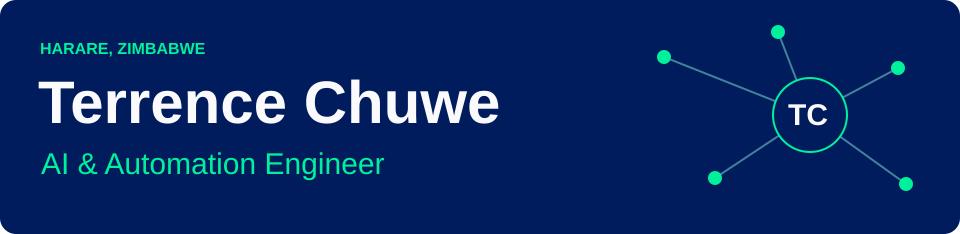
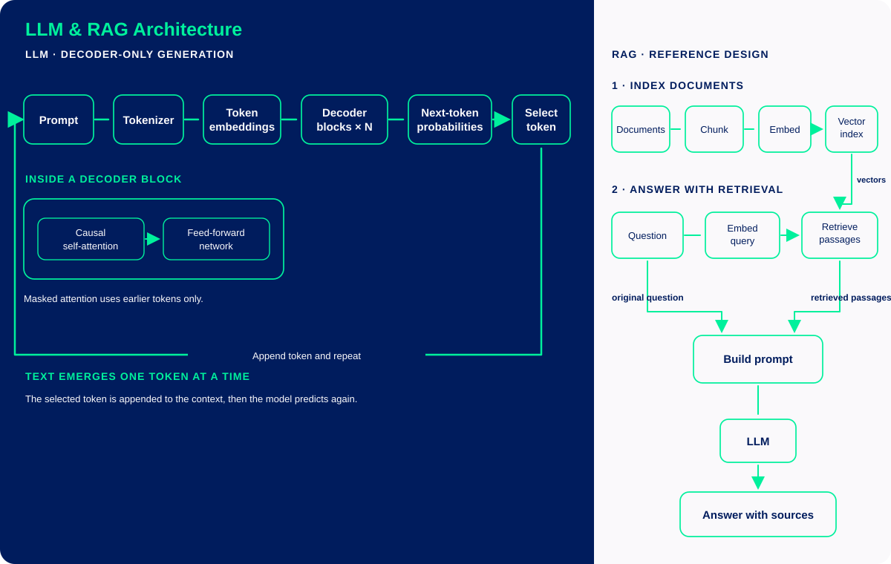

I build AI tools for the people who use them day to day. At Cassava Technologies, I work on network reporting, retrieval-augmented generation, and GPU inference. Before that, I built backend services and UiPath automations for teams across Southern and East Africa.

[LinkedIn](https://www.linkedin.com/in/terrence-chuwe-1a5615190/) · [Email](mailto:tchuwe41@gmail.com)

## Selected projects

| Project | What you can explore |
| --- | --- |
| [StoreBridge](https://github.com/PAPA-CHUWE/storebridge) | Follow a supplier listing into an AI-assisted product draft, then through Saleor to the Next.js storefront. The README maps the implemented flow and the roadmap. |
| [VektorCode](https://github.com/PAPA-CHUWE/vektorcode) | A Python coding agent that connects to an OpenAI-compatible endpoint to inspect a project, edit files, and run tests. |
| [Climate Risk & Health Prediction](https://github.com/PAPA-CHUWE/Climate-Risk-and-Health-Prediction-Challenge) | A Zindi project exploring how climate and health data can help predict climate-sensitive mortality in Uganda. |

## Skills

**GPU & Model Deployment**

  

At Cassava Technologies, I configured NVIDIA H200 GPU environments and loaded language models for inference.

**LLMs & Retrieval**

        

**Model Evaluation**

     

**Computer Vision & Video Analytics**

   

**Document Processing**

     

**Workflow Design & Financial Automation**

     

**Multi-Tenant Application Design**

   

**Databases & Infrastructure**

            

**Backend, Web & Mobile Development**

          ") 

**Technical Communication**

  

## Tech stack

**Languages & APIs**  
      

**Web, mobile & data**

    

**Build & delivery**  
  

**Infrastructure & automation**

    

**Computer vision**

 

## LLM & RAG Architecture

A reference architecture for decoder-only text generation and retrieval-augmented question answering. It illustrates a general pattern, not the implementation of any featured project.

